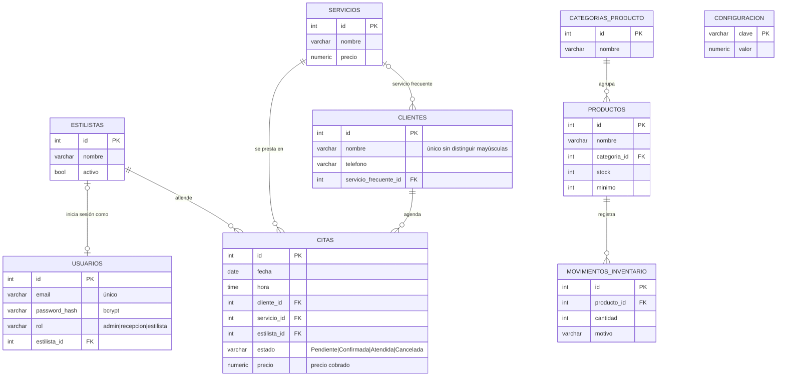

# Base de datos · SalonFlow ERP

Base de datos PostgreSQL alojada en **Supabase**: usuarios y roles, citas sin cruces de horario, clientes, inventario con movimientos de stock, comisiones con tasa configurable y reportes. La usa la API de `backend/`.

## Archivos

| Archivo | Para qué sirve |
|---|---|
| `supabase/salonflow_supabase.sql` | **Instalación en Supabase en un solo paso** (esquema + seguridad + datos de prueba). Archivo generado. |
| `supabase/generar.sh` | Regenera el archivo anterior después de cambiar `01` o `02`. |
| `01_esquema.sql` | Tablas, reglas, vistas y funciones de reporte. |
| `02_datos_prueba.sql` | Datos equivalentes a `mockData.js`, con fechas relativas a hoy. |
| `03_consultas.sql` | Consultas de referencia por funcionalidad (las que implementa `backend/app/repositories`). |

## Instalar en Supabase

1. Crear el proyecto en [supabase.com](https://supabase.com) (región recomendada: `South America (São Paulo)`).
2. Ir a **SQL Editor → New query**, pegar todo `supabase/salonflow_supabase.sql` y pulsar **Run**.
3. Verificar en **Table Editor** que existen las 8 tablas, o ejecutar:
   ```sql
   SELECT * FROM v_citas WHERE fecha = CURRENT_DATE ORDER BY hora;
   SELECT * FROM fn_comisiones();
   ```

> Volver a ejecutar el script **borra y recrea todo**, incluidos los datos.

### Conectarse desde el backend

En Supabase: **Connect → Connection string → URI → Session pooler**. Esa cadena va en `backend/.env` como `DATABASE_URL` (ver `backend/.env.example`):

```
DATABASE_URL=postgresql://postgres.<id-proyecto>:<contraseña>@aws-0-<region>.pooler.supabase.com:5432/postgres?sslmode=require
```

El archivo `.env` **no se sube a GitHub** (está en `.gitignore`).

### Seguridad

Supabase publica automáticamente las tablas como API REST con una clave pública (`anon`). Por eso todas las tablas tienen **RLS activado y sin políticas**: con la clave pública no se puede leer ni escribir nada. Solo la API (FastAPI), que se conecta con la cadena de conexión, accede a los datos; el control por rol (admin, recepción, estilista) se hace en la API con JWT.

## Modelo de datos



## Reglas de negocio en la base de datos

| Regla del prototipo | Cómo se garantiza |
|---|---|
| Un estilista no puede tener dos citas a la misma hora (`Cita.hayConflicto`) | Índice único parcial `ux_citas_sin_cruce` (las citas canceladas liberan el horario) |
| No hay clientes repetidos (`Cliente.existe`) | Índice único sobre `lower(trim(nombre))` |
| El stock nunca baja de 0 (`Producto.ajustar`) | Trigger en `movimientos_inventario`, que además deja el historial de ajustes |
| Comisión = precio × tasa (30 % por defecto) | `configuracion.tasa_comision` + `fn_comisiones()` |
| Última visita y clientes inactivos | Se calculan desde las citas `Atendida` (vista `v_clientes`) |
| Cada atención queda registrada como venta | Estado `Atendida` + precio cobrado en `citas` |
| Correos de usuario únicos y estilista con un solo usuario | Índice único sobre `lower(email)` y `UNIQUE(estilista_id)` |

**Cambio respecto al prototipo:** se agregó el estado `Atendida`. Las comisiones y los reportes salen de las citas realmente atendidas y ya no de cifras fijas.

## Usuarios de prueba

| Correo | Contraseña | Rol |
|---|---|---|
| admin@salonflow.co | Admin123* | Administrador |
| recepcion@salonflow.co | Recepcion123* | Recepción |
| hector@salonflow.co · valeri@… · miguel@… | Estilista123* | Estilista |

Las contraseñas se guardan como hash bcrypt. Cámbialas antes de usar el sistema con datos reales.

## Pendiente

- Consumo automático de insumos por servicio (`servicio_producto`).
