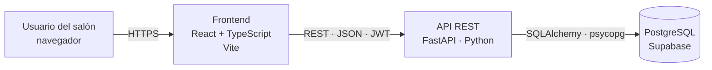

# SalonFlow ERP

Plataforma web para administrar peluquerías y barberías de barrio: agenda de citas sin cruces de horario, clientes con historial, inventario con alertas de stock, comisiones por estilista y reportes.

> El módulo de inteligencia artificial está planeado para una fase posterior y no hace parte de este prototipo.

**Equipo:** Hector Figueroa · Valeri Atuesta · Miguel Coronado
**Materia:** Arquitectura de Software · Universidad Manuela Beltrán · Docente: Jamilton Fernando Benavides

---

## Arquitectura



El backend está organizado **por capas** (cada capa solo llama a la de abajo):

| Capa | Carpeta | Responsabilidad |
|---|---|---|
| Presentación | `backend/app/routers/` | Endpoints HTTP, validación de entrada (Pydantic), permisos por rol |
| Aplicación | `backend/app/services/` | Reglas de negocio (horarios, cruces, flujo de estados, stock…) |
| Datos | `backend/app/repositories/` + `models/` | Consultas SQL y modelos ORM (SQLAlchemy) |
| Base de datos | `BaseDeDatos/` | Esquema, restricciones, triggers, vistas y funciones de reporte |

Las reglas críticas se validan **dos veces**: en la API (mensaje claro para el usuario) y en la base de datos (garantía final). Ejemplo: el cruce de citas lo revisa `services/citas.py` y además lo impide el índice único `ux_citas_sin_cruce`.

## Estructura del repositorio

```
├── backend/            API REST (FastAPI)
│   ├── app/
│   │   ├── core/          configuración, conexión, seguridad JWT, manejo de errores
│   │   ├── models/        modelos ORM
│   │   ├── schemas/       validación de entrada/salida (Pydantic)
│   │   ├── repositories/  acceso a datos
│   │   ├── services/      reglas de negocio
│   │   └── routers/       endpoints
│   └── tests/          38 pruebas de integración (pytest)
├── frontend/           Interfaz web (React + TypeScript + Vite)
│   └── src/
│       ├── api/           cliente HTTP con manejo de errores
│       ├── auth/          sesión y control de acceso por rol
│       ├── components/    layout y componentes reutilizables
│       └── pages/         una página por módulo
├── BaseDeDatos/        Scripts SQL para Supabase/PostgreSQL
├── docs/               Guía de auditoría y demo
├── scripts/            Script de inicio para Windows (lo llama INICIAR-WINDOWS.bat)
├── FrontEnd/           Prototipo de la fase 2 (HTML/JS con datos simulados, publicado en GitHub Pages)
└── .github/workflows/  CI: pruebas del backend y build del frontend en cada push
```

## Cómo ejecutarlo

> **¿Computador sin nada instalado?** Sigue [`COMO_EJECUTAR.md`](COMO_EJECUTAR.md): doble clic en `INICIAR-WINDOWS.bat` (o `bash iniciar-mac-linux.sh`), o despliegue en línea con Render usando `render.yaml`. Lo de abajo es para desarrollar.


### 1. Base de datos (Supabase)

1. Crear un proyecto en [supabase.com](https://supabase.com).
2. **SQL Editor → New query**: pegar todo `BaseDeDatos/supabase/salonflow_supabase.sql` y **Run**.
3. Copiar la cadena de conexión: **Connect → Connection string → URI → Session pooler**.

> Alternativa local: PostgreSQL 14+ y ejecutar `01_esquema.sql` y `02_datos_prueba.sql`.

### 2. Backend

```bash
cd backend
python -m venv .venv
# Windows: .venv\Scripts\activate    ·    Mac/Linux: source .venv/bin/activate
pip install -r requirements.txt
cp .env.example .env        # completar DATABASE_URL y JWT_SECRET
uvicorn app.main:app --reload
```

- API: http://localhost:8000
- **Documentación interactiva (Swagger):** http://localhost:8000/api/docs
- Estado: http://localhost:8000/api/health

### 3. Frontend

```bash
cd frontend
npm install
npm run dev
```

Abrir http://localhost:5173. En desarrollo, Vite redirige `/api` al backend.

Para producción, `npm run build` genera `frontend/dist`, que el backend entrega directamente en http://localhost:8000 (un solo servidor). Esa carpeta se incluye en el repositorio para poder ejecutar el sistema sin Node.

### Usuarios de prueba

| Correo | Contraseña | Rol | Puede |
|---|---|---|---|
| admin@salonflow.co | Admin123* | Administrador | Todo |
| recepcion@salonflow.co | Recepcion123* | Recepción | Citas, clientes, inventario |
| hector@salonflow.co | Estilista123* | Estilista | Solo su agenda y su comisión |

## Módulos y endpoints

Todos bajo `/api/v1` y protegidos con JWT (`Authorization: Bearer <token>`), excepto el login.

| Módulo | Endpoints principales | Roles |
|---|---|---|
| Autenticación | `POST /auth/login`, `GET /auth/me` | Todos |
| Usuarios | `GET/POST /usuarios`, `PATCH /usuarios/{id}` | Admin |
| Catálogos | `GET /estilistas`, `GET/POST/PATCH /servicios`, `GET /categorias` | Todos (escritura: admin) |
| Clientes | `GET/POST /clientes`, `GET/PATCH /clientes/{id}`, `GET /clientes/{id}/historial` | Admin, recepción |
| Citas | `GET/POST /citas`, `GET /citas/disponibilidad`, `PATCH /citas/{id}/estado` | Todos (estilista: solo las suyas) |
| Inventario | `GET/POST /productos`, `PATCH /productos/{id}`, `GET/POST /productos/{id}/movimientos` | Admin, recepción |
| Comisiones | `GET /comisiones`, `PUT /comisiones/tasa` | Admin (estilista: solo la suya) |
| Reportes | `GET /dashboard`, `GET /reportes/resumen`, `/servicios-populares`, `/ocupacion` | Admin |

Todas las respuestas de error tienen la misma forma:

```json
{ "detalle": "Valeri Atuesta ya tiene una cita a las 10:00 ese día.",
  "errores": [{ "campo": "hora", "mensaje": "Horario ocupado. Elige otra hora." }] }
```

| Código | Cuándo |
|---|---|
| 401 | Sin sesión, token inválido o vencido |
| 403 | El rol no tiene permiso |
| 404 | El registro no existe |
| 409 | Duplicado o conflicto (cliente repetido, cita cruzada) |
| 422 | Datos inválidos o regla de negocio incumplida |
| 503 | Base de datos no disponible |

## Pruebas

```bash
cd backend
pip install -r requirements-dev.txt
pytest -v      # necesita PostgreSQL local; usa TEST_DATABASE_URL (por defecto salonflow_test en localhost)
```

Las 38 pruebas crean una base limpia desde los scripts SQL del repositorio y cubren autenticación, permisos por rol, cruces de citas, validaciones, flujo de estados, inventario, comisiones y reportes. GitHub Actions las ejecuta en cada push (`.github/workflows/ci.yml`).

## Despliegue sugerido

| Parte | Servicio | Configuración |
|---|---|---|
| Base de datos | Supabase | Script `salonflow_supabase.sql` |
| Backend + interfaz | Render (Blueprint con `render.yaml`) | Un solo servicio: la API entrega también `frontend/dist`. Solo hay que pegar `DATABASE_URL`. |
